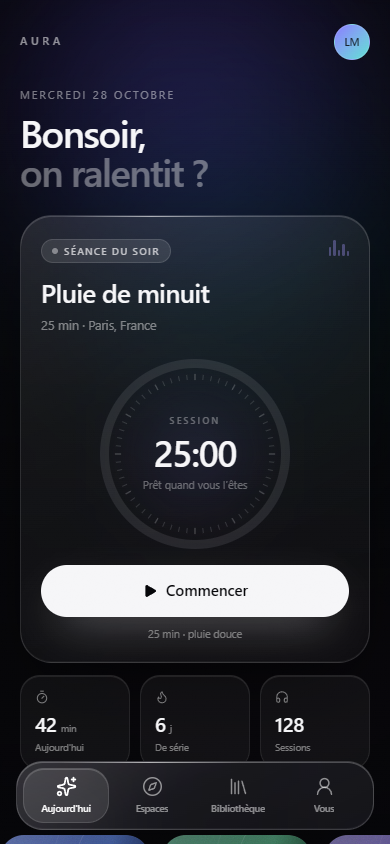
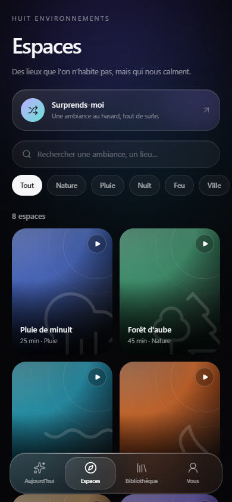
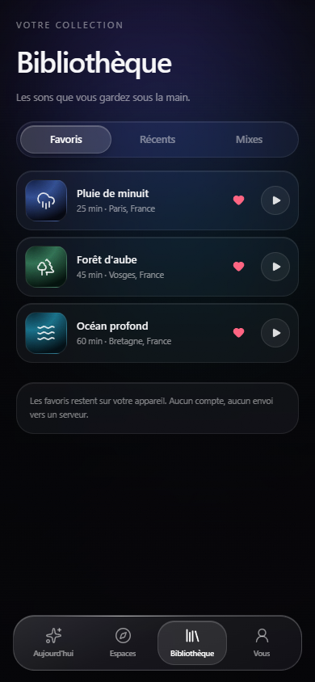
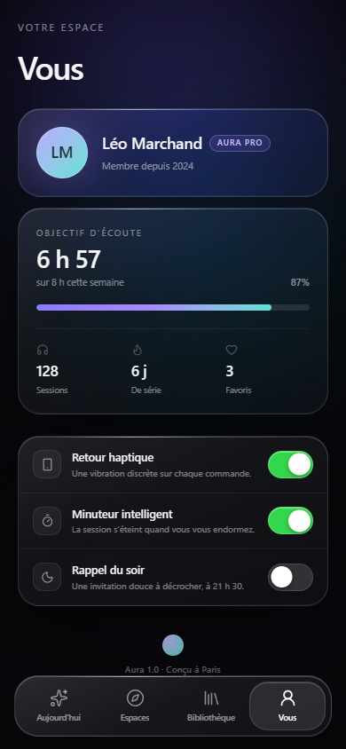
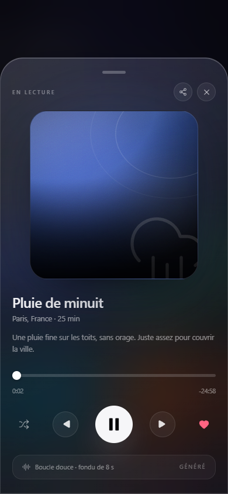

# Aura

Une app iPhone d'ambiances sonores et de concentration, en **liquid glass**, avec une barre de navigation flottante arrondie et translucide, quatre onglets et des transitions physiques dignes d'iOS.

| Aujourd'hui | Espaces |
| --- | --- |
|  |  |

| Bibliothèque | Vous |
| --- | --- |
|  |  |

| Lecteur |
| --- |
|  |

> Captures prises dans Chromium au viewport 390 × 844. Sur iPhone, la typographie est SF Pro (police système) et les matériaux sont rendus par le WebView.

## L'app

Aura est un lecteur d'ambiances pour ralentir : une séance du soir, des lieux à écouter, une bibliothèque de favoris et un profil avec objectif d'écoute. L'interface est pensée comme une app iOS native :

- **Quatre onglets** — Aujourd'hui, Espaces, Bibliothèque, Vous.
- **Tab bar flottante** — capsule arrondie en verre dépoli, pastille de sélection animée par ressort partagé (`layoutId`), halo spéculaire sur l'arête supérieure.
- **Liquid glass partout** — trois épaisseurs de matériau (`.glass`, `.glass-strong`, `.glass-soft`), bord lumineux, ombres internes, grain et flou d'arrière-plan.
- **Lecteur plein écran** — feuille glissable à la main, fermeture à la vélocité, progression scrubbable, favoris, ambiance précédente/suivante, aléatoire, partage natif.
- **Mini-lecteur** — au-dessus de la tab bar, avec progression et lecture/pause, comme dans Musique.
- **Recherche et filtres** — par ambiance, lieu ou humeur, avec état vide soigné.
- **Favoris persistants** — stockés localement sur l'appareil.
- **Haptiques** — via Capacitor Haptics sur iPhone (aucun bruit sur le web).
- **Responsive** — colonne unique sur iPhone, grilles 3/4 colonnes sur iPad et grand écran.

## Stack

| Rôle | Outil |
| --- | --- |
| UI | React 19 + TypeScript |
| Build | Vite 8 |
| Style | Tailwind CSS 4, primitives façon shadcn/ui (`cva`, `cn`, composants composables) |
| Motion | Motion (ex-Framer Motion), ressorts, `layoutId`, drag avec vélocité |
| Icônes | Lucide |
| Effets | Spotlight, Background Beams et Card Spotlight réécrits dans l'esprit d'Aceternity UI |
| iOS | Capacitor 8, projet Xcode en Swift Package Manager |
| CI | GitHub Actions sur macOS, IPA non signé en artifact |

## Démarrage

```bash
npm install
npm run dev
```

Le serveur Vite écoute sur `http://localhost:5173`. Pour build :

```bash
npm run build
npm run preview
```

Vérification du code :

```bash
npm run lint
```

## Structure

```
src/
  App.tsx                     coquille, aurora, onglets, lecteur
  components/
    aceternity/               spotlight, background beams
    tabs/                     les quatre écrans
    ui/                       matériaux et contrôles (button, toggle, segmented, slider…)
    FocusRing.tsx             anneau de minuterie
    TabBar.tsx                capsule liquid glass flottante
    NowPlaying.tsx            feuille de lecture glissable
    MiniPlayer.tsx            mini-lecteur au-dessus de la tab bar
    SpaceArt.tsx              pochettes générées par gradients
  lib/
    data.ts                   ambiances, mixes, profil, données de démo
    usePlayer.ts              timer, progression, seek, favoris
    haptics.ts                pont Capacitor Haptics
    utils.ts                  cn(), formats de temps
ios/                          projet Xcode Capacitor (SPM)
.github/workflows/ios.yml     build macOS → IPA
```

## Construire l'IPA avec GitHub Actions

Le workflow **iOS IPA** se déclenche à chaque push sur `main` et manuellement depuis l'onglet **Actions**.

```bash
git push origin main
gh run watch
```

Il :

1. installe les dépendances et build le web ;
2. synchronise le projet Capacitor ;
3. compile l'app en Release pour `iphoneos`, sans signature ;
4. empaquette `Payload/App.app` en `Aura-1.0.0-unsigned.ipa` ;
5. publie l'IPA dans les artifacts du run (`aura-ios-ipa`).

### Signer l'IPA

Le dépôt ne contient aucun certificat Apple : l'artifact est **non signé**, il ne s'installe donc pas tel quel. Pour le faire tourner sur un iPhone :

- **Sideloadly** ou **AltStore** re-signent l'IPA avec un identifiant Apple gratuit (validité 7 jours, à re-signer ensuite) ou un compte développeur payant (1 an) ;
- pour une distribution TestFlight/App Store, il faut ajouter un certificat de distribution, un profil de provisioning et une étape `xcodebuild -exportArchive` avec `ExportOptions.plist` dans le workflow.

### Réglages iOS

- Bundle : `com.leboxis.aura`
- Cible : iOS 15+
- Style d'interface forcé en sombre, barre d'état en surimpression
- Icône et écran de lancement générés pour Aura

## Design & accessibilité

- **Typographie** : SF Pro (système), tracking négatif sur les grands titres, leading serré, `tabular-nums` sur le temps.
- **Ressorts** : aucun rebond sur les surfaces qui apparaissent, rebond léger réservé aux gestes qui portent de la vélocité.
- **Feedback** : press sur `pointer-down` (`.press:active`), haptique sur les bascules et changements d'onglet.
- **Mouvement réduit** : `prefers-reduced-motion` supprime les translations et les animations en boucle, garde les fondus.
- **Transparence réduite / contraste élevé** : les matériaux deviennent opaques et lisibles.
- **Cibles tactiles** ≥ 44 px, focus visible, rôles ARIA (`tablist`, `switch`, `dialog`, `timer`), fermeture du lecteur au clavier.

## Limites connues

- **Pas encore d'audio** : les ambiances sont des pochettes générées et le lecteur gère le temps, la pause et la progression, mais ne synthétise pas de son. C'est le prochain chantier naturel (Web Audio ou fichiers loopés).
- Les données (favoris, historique, profil) sont de démonstration, à l'exception des favoris persistés localement.
- L'IPA produit par la CI est non signé, par construction.
- Les captures sont faites sous Chromium ; le rendu final sur iPhone utilise SF Pro et les safe areas réelles.

## Crédits

Design inspiré des Human Interface Guidelines d'Apple et de la direction « liquid glass » d'iOS 26. Composants d'effets inspirés d'[Aceternity UI](https://ui.aceternity.com), primitives dans l'esprit de [shadcn/ui](https://ui.shadcn.com), icônes [Lucide](https://lucide.dev), animations [Motion](https://motion.dev). Projet de démonstration, sans affiliation avec Apple.
