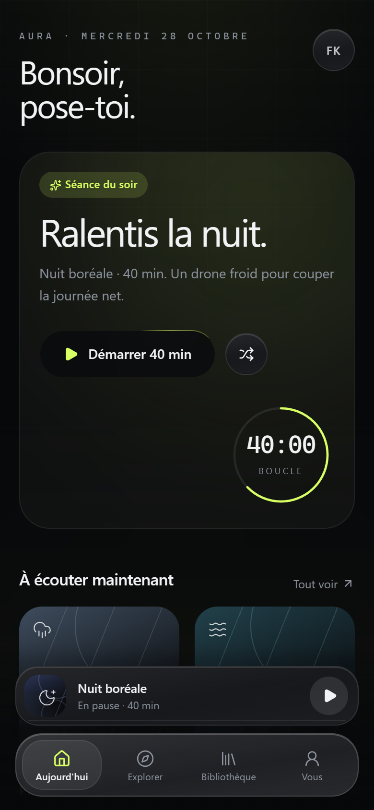
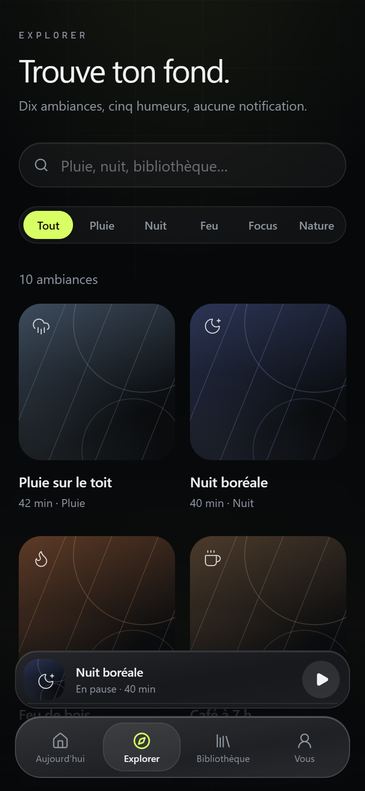
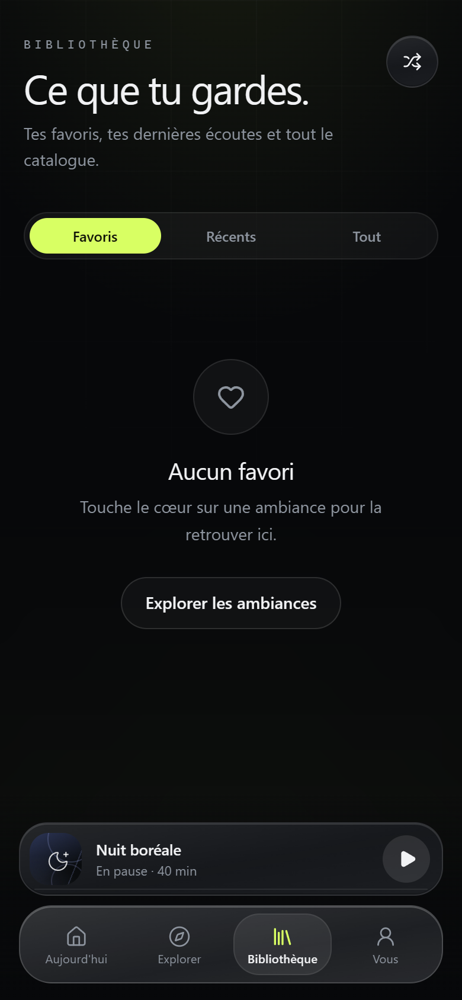
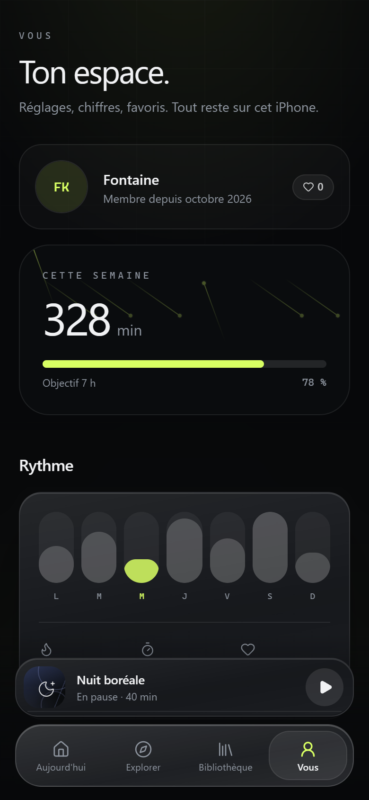
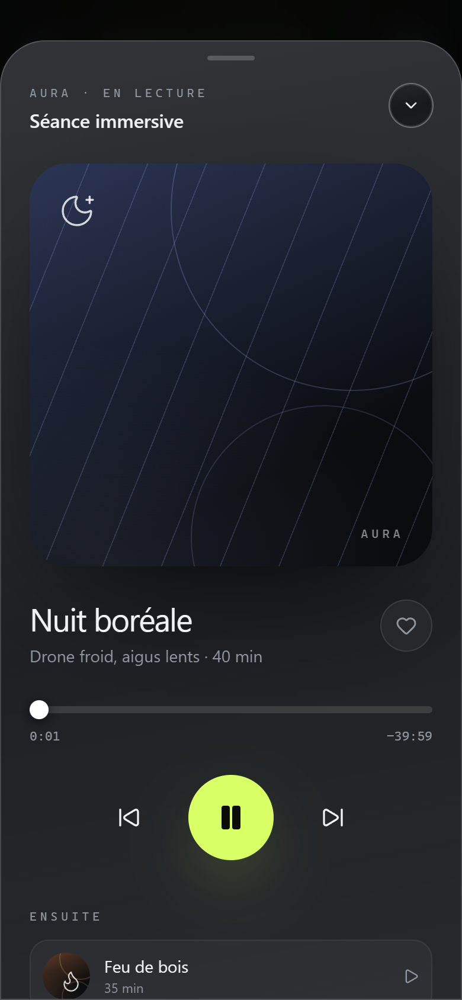
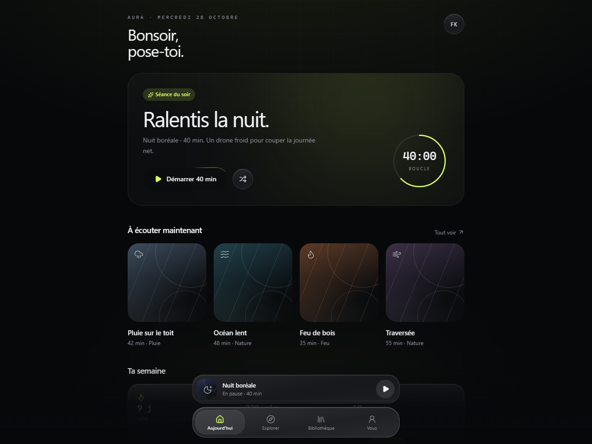

# Aura

Une app iPhone d'ambiances et de concentration, reconstruite de zéro avec **shadcn/ui**, **Aceternity UI**, **Motion**, **Lucide** et **Tailwind CSS**. Direction graphite et lime, tab bar en verre et lecteur plein écran.

| Aujourd'hui | Explorer |
| --- | --- |
|  |  |

| Bibliothèque | Vous |
| --- | --- |
|  |  |

| Lecteur | Grand écran |
| --- | --- |
|  |  |

> Captures prises dans Chromium à 390 × 844 (et 1280 × 960 pour la dernière). Sur iPhone, la typographie est SF Pro et les matériaux sont rendus par le WebView.

## L'app

Dix ambiances, un minuteur, des favoris et un objectif d'écoute. L'interface est pensée comme une app iOS native :

- **Quatre onglets** — Aujourd'hui, Explorer, Bibliothèque, Vous.
- **Tab bar flottante** — capsule en verre de 28 px de rayon, pastille de sélection animée par `layoutId`, retour haptique.
- **Hero spotlight** — carte qui suit le pointeur, halo lime, titre révélé mot à mot, anneau de séance et bordure lumineuse rotative sur l'action principale.
- **Pochettes génératives** — gradients, lignes diagonales, anneaux et grain, avec un glyphe Lucide par ambiance ; aucune image externe.
- **Lecteur** — feuille `Sheet` plein écran, faisceaux animés, progression scrubbable, favoris, précédent/suivant, file d'attente.
- **Mini-lecteur** — au-dessus de la tab bar, progression fine et lecture/pause.
- **Recherche et filtres** — champ arrondi, onglets d'humeur Radix, état vide et réinitialisation.
- **Favoris et réglages persistants** — localStorage ; haptiques Capacitor sur iPhone.
- **Responsive** — une colonne sur iPhone, grilles 3/4 colonnes et hero horizontal sur iPad et grand écran.

## Stack

| Rôle | Outil |
| --- | --- |
| UI | React 19 + TypeScript |
| Build | Vite 8 |
| Design system | **shadcn/ui** (Radix) : `button`, `card`, `tabs`, `input`, `slider`, `switch`, `badge`, `avatar`, `progress`, `separator`, `sheet` |
| Effets | **Aceternity UI** : Spotlight, Background Beams, Meteors, Card Spotlight, Text Generate, Hover Border Gradient |
| Motion | **Motion** — ressorts, `layoutId`, révélations, respect de `prefers-reduced-motion` |
| Icônes | **Lucide** |
| Style | **Tailwind CSS 4** — tokens OKLCH/hex, utilitaires `glass`, `glass-strong`, `glass-soft`, `grain` |
| iOS | Capacitor 8, projet Xcode en Swift Package Manager |
| CI | GitHub Actions sur macOS, IPA non signé en artifact |

Les composants shadcn sont versionnés dans [`src/components/ui`](src/components/ui) (`components.json` à la racine) : ils appartiennent au projet et se modifient directement.

## Démarrage

```bash
npm install
npm run dev
```

Le serveur Vite écoute sur `http://localhost:5173`. Pour build :

```bash
npm run build
npm run preview
```

Vérification : `npm run lint` (0 erreur) et `npx tsc -b`.

## Structure

```
src/
  App.tsx                     coquille, fond ambiant, dock, feuille de lecture
  components/
    aceternity/               spotlight, beams, meteors, card spotlight, text generate, border gradient
    app/                      SpaceArt, SpaceCard, TabBar, MiniPlayer, PlayerSheet, Screen
    ui/                       primitives shadcn (button, sheet, tabs, slider, switch…)
  screens/                    HomeScreen, ExploreScreen, LibraryScreen, ProfileScreen
  lib/
    data.ts                   ambiances, humeurs, statistiques
    player.tsx                contexte lecteur : file, temps, favoris, réglages
    haptics.ts                pont Capacitor Haptics
    tabs.ts                   identifiants d'onglets
    utils.ts                  cn(), formats de temps
ios/                          projet Xcode Capacitor (SPM)
livecontainer/                dépôt JSON + IPA pour LiveContainer
.github/workflows/ios.yml     build macOS → IPA
```

## Construire l'IPA avec GitHub Actions

Le workflow **iOS IPA** se déclenche à chaque push sur `main` et manuellement depuis l'onglet **Actions**.

```bash
git push origin main
gh run watch
```

Il :

1. installe les dépendances et build le web ;
2. synchronise le projet Capacitor ;
3. compile l'app en Release pour `iphoneos`, sans signature ;
4. empaquette `Payload/App.app` en `Aura-1.0.0-unsigned.ipa` ;
5. publie l'IPA dans les artifacts du run (`aura-ios-ipa`).

### Signer l'IPA

Le dépôt ne contient aucun certificat Apple : l'artifact est **non signé**, il ne s'installe donc pas tel quel. Pour le faire tourner sur un iPhone :

- **Sideloadly** ou **AltStore** re-signent l'IPA avec un identifiant Apple gratuit (validité 7 jours, à re-signer ensuite) ou un compte développeur payant (1 an) ;
- pour une distribution TestFlight/App Store, il faut ajouter un certificat de distribution, un profil de provisioning et une étape `xcodebuild -exportArchive` avec `ExportOptions.plist` dans le workflow.

### Installer via LiveContainer

Le dossier [`livecontainer/`](livecontainer/README.md) publie l'IPA et deux formats de dépôt : `source.json` pour LBox et `repo.json` pour LC-DL.

- Release : https://github.com/Leboxis/aura-ios/releases/tag/com.leboxis.aura
- Source LBox : `https://raw.githubusercontent.com/Leboxis/aura-ios/refs/heads/main/livecontainer/source.json`
- Dépôt LC-DL : `https://raw.githubusercontent.com/Leboxis/aura-ios/refs/heads/main/livecontainer/repo.json`

### Réglages iOS

- Bundle : `com.leboxis.aura`
- Cible : iOS 15+
- Style d'interface forcé en sombre, barre d'état en surimpression
- Icône et écran de lancement générés pour Aura

## Design & accessibilité

- **Palette** : graphite `#07080a`, texte `#f1f2f4`, accent lime `#d8ff63` réservé aux actions et aux chiffres clés.
- **Matériaux** : trois épaisseurs de verre, arête lumineuse, grain, ombres internes ; replis opaques en `prefers-reduced-transparency`.
- **Typographie** : SF Pro sur iPhone, titres à tracking négatif, monospace et `tabular-nums` pour les temps.
- **Mouvement** : ressorts sans rebond superflu, `prefers-reduced-motion` coupe translations et boucles.
- **Feedback** : press sur `active:scale`, haptique sur les onglets, favoris, lecture et réglages.
- **Accessibilité** : cibles ≥ 44 px, focus visible, rôles Radix (`tablist`, `switch`, `dialog`, `slider`), libellés sur tous les boutons-icônes.

## Limites connues

- **Pas encore d'audio** : les ambiances sont des visuels ; le lecteur gère temps, pause, progression et enchaînement, mais ne synthétise pas de son. Prochain chantier : Web Audio ou boucles.
- Les statistiques et le profil sont des données de démonstration ; favoris et réglages sont réels et persistés localement.
- L'IPA produit par la CI est non signé, par construction.
- Les captures sont faites sous Chromium ; sur iPhone, SF Pro et les safe areas réelles prennent le relais.

## Crédits

Composants d'effets inspirés d'[Aceternity UI](https://ui.aceternity.com), primitives [shadcn/ui](https://ui.shadcn.com), icônes [Lucide](https://lucide.dev), animations [Motion](https://motion.dev), styles [Tailwind CSS](https://tailwindcss.com). Projet de démonstration, sans affiliation avec Apple.
